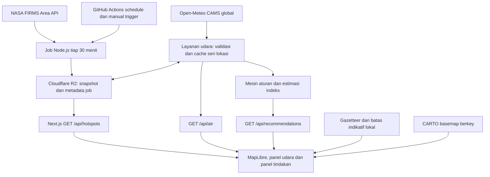

# 02 — Arsitektur dan Aliran Data

**Dokumen aktif v1.0 · 27 Oktober 2026 · Implementasi direncanakan.**

Mengimplementasikan FR-01–FR-08 pada [PRD](01-PRODUCT-REQUIREMENTS.md). Arsitektur awal memakai satu aplikasi Next.js, job Node.js, dan object storage persisten. Tidak memerlukan database geospasial, monorepo, atau backend NestJS. MongoDB pada situs referensi adalah temuan studi, bukan kebutuhan CP.

## 1. Komponen dan alur



Tiga route publik berjalan pada runtime Node.js. Browser tidak mengakses kredensial NASA/R2 atau bucket secara langsung. Key CARTO yang diizinkan provider untuk browser merupakan konfigurasi publik yang dibatasi domain, terpisah dari key server.

## 2. Hosting dan scheduler

- **Web/API:** Vercel untuk Next.js dan runtime Node.js; konfigurasi timeout, cache dan environment dicatat saat M0.
- **Storage:** bucket privat Cloudflare R2 melalui adapter S3. Simpan snapshot, pointer terbaru, metadata usaha pengambilan dan cache seri udara; API menerbitkan subset aman untuk pengguna.
- **Hotspot worker:** job CLI Node.js pada GitHub Actions, target `7,37 * * * *` UTC. Workflow manual memakai entrypoint dan concurrency group yang sama. Tidak ada akun/key/workflow yang dibuat oleh perubahan dokumentasi ini.
- **Kepemilikan jadwal:** satu workflow writer, `cancel-in-progress: false`; jangan menjalankan penulis manual di luar mekanisme yang sama. Job mempunyai timeout, retry terbatas, dan ID run. Kandidat yang lebih lama tidak menimpa pointer baru.
- **Keterlambatan scheduler:** waktu cron bukan SLA. Pantau `lastAttemptAt`, `lastSuccessAt` dan umur snapshot; keterlambatan tercermin sebagai status data. Jangan bergantung pada cron Vercel Hobby untuk interval 30 menit.

Rujukan: [GitHub schedule](https://docs.github.com/en/actions/reference/workflows-and-actions/events-that-trigger-workflows#schedule), [batas cron Vercel](https://vercel.com/docs/cron-jobs/usage-and-pricing), [S3 API R2](https://developers.cloudflare.com/r2/api/s3/api/).

## 3. Pipeline hotspot

Sumber awal: `VIIRS_SNPP_NRT`, `VIIRS_NOAA20_NRT`, `VIIRS_NOAA21_NRT` pada [NASA FIRMS Area API](https://firms.modaps.eosdis.nasa.gov/api/area/).

Template upstream hanya dipakai server/job:

```text
https://firms.modaps.eosdis.nasa.gov/api/area/csv/{FIRMS_MAP_KEY}/{source}/{west,south,east,north}/{days}/{startDate}
```

1. Tetapkan waktu evaluasi run UTC dan jendela 7 hari bergerak. Ambil semua tanggal kalender yang beririsan; biasanya mencakup delapan tanggal, bukan selalu tujuh.
2. Pecah tanggal menjadi batch maksimal lima hari per source. Query bbox Indonesia hanya menyusutkan unduhan; belum menentukan kewargaan setiap titik.
3. Periksa status HTTP, header CSV yang diharapkan, baris numerik, confidence, koordinat dan tanggal yang sesuai rentang request. Error berbentuk teks tidak diterima sebagai nol deteksi.
4. Normalkan ke tipe pada 04, deduplikasi teknis berdasarkan identitas deteksi, lalu potong memakai geometri indikatif Indonesia. Simpan cakupan per source dan tanggal yang berhasil/gagal.
5. Tulis payload immutable dengan snapshot ID, checksum, versi skema dan versi batas. Jika ada source gagal tetapi sebagian data valid, kandidat boleh berstatus partial dan menyebut kekurangannya. Nol sah membutuhkan keberhasilan parsing dan cakupan yang dinyatakan.
6. Setelah payload valid tersimpan, perbarui pointer `current.json`. Jika seluruh pengambilan gagal, pertahankan pointer lama; catat kegagalan pada metadata job. Tidak mengganti snapshot baik dengan array kosong buatan.
7. API membaca snapshot dan metadata job, menyaring interval/filter pengguna, mengevaluasi status berdasarkan 04, lalu mengirim ringkasan yang jujur terhadap cakupan.

Saat pertama kali berjalan, job mengambil ulang tanggal yang dibutuhkan dari upstream untuk membangun jendela 7d; histori aplikasi tidak harus menunggu tujuh hari. Pengambilan berikutnya juga merekonsiliasi jendela itu agar deteksi yang terlambat diterima dapat masuk. Retensi snapshot berbeda dari panjang jendela data; kebijakan kanonis pada 04.

## 4. Layanan kualitas udara per lokasi

Endpoint upstream MVP:

```text
https://air-quality-api.open-meteo.com/v1/air-quality
  ?latitude={lat}&longitude={lon}&hourly=pm2_5
  &domains=cams_global&past_days=2&forecast_days=3
  &timezone=GMT&timeformat=unixtime
```

Permintaan ini menyediakan jam sebelumnya untuk indeks dan jam mendatang untuk prakiraan; adapter tetap memvalidasi waktu serta nilai yang benar-benar dikembalikan. Jangan menganggap seluruh rentang selalu tersedia. Riwayatnya adalah keluaran model/arsip prakiraan, bukan pengukuran stasiun.

- Validasi lokasi terhadap area layanan. Normalisasi koordinat query ke 0,01° sebagai bucket cache teknis; ini bukan peningkatan resolusi model.
- Cache **seri per jam**, bukan hanya hasil indeks jam saat request pertama. Respons tiap request diturunkan ulang berdasarkan waktu server kini, sehingga berganti jam tidak mempertahankan panel jam lama.
- Simpan koordinat request saat ini dan koordinat grid yang dikembalikan provider secara terpisah. Jika provider tidak memberi run model, simpan `runAt: null`; jangan menciptakan timestamp model dari waktu fetch.
- Gunakan TTL, fallback, timeout dan status pada 04. Kegagalan boleh memakai seri cache persisten yang masih layak ditampilkan, dengan label stale; rekomendasi terarah diblokir pada data yang tidak memenuhi syarat.
- Coalesce request serentak dalam instance, batasi laju lintas request melalui rate limiter hosting atau adapter layanan yang disediakan saat M0, dan batasi cakupan/koordinat. Cache sendiri bukan jaminan kuota tidak terlampaui.

Rujukan: [Air Quality API](https://open-meteo.com/en/docs/air-quality-api). Jika penggunaan CP masuk kategori komersial, gunakan paket/endpoint customer yang sesuai; adapter menyimpan base URL/key di server. Periksa [ketentuan penggunaan](https://open-meteo.com/en/terms) pada M0; tidak ada pembelian paket melalui pekerjaan dokumen ini.

## 5. Indeks dan rekomendasi

Layanan udara memanggil fungsi murni perhitungan indeks pada 04. `/api/recommendations` mengambil data dari layanan yang sama lalu mengevaluasi aturan berversi. Browser hanya memberikan lokasi dan enum kelompok, bukan nilai polutan/indeks tepercaya.

- Panel tindakan memakai jam kini server, tidak mengikuti filter historis hotspot atau jam prakiraan yang sedang ditinjau pengguna.
- Metadata sumber, metode, lokasi dan periode data ikut dalam alasan rekomendasi. Komponen udara/tindakan harus membandingkan `dataVersion` agar tidak menampilkan satu nilai dengan alasan dari seri lain.
- Data stale/partial/unavailable, input indeks kurang, atau rekomendasi yang kedaluwarsa menghasilkan keluaran keterbatasan dan tautan pedoman umum.
- Rekomendasi paparan tidak ditentukan oleh jumlah/jarak hotspot. Tautan otoritas hanya berasal dari katalog terverifikasi.

## 6. Object storage, publikasi dan pemulihan

```text
hotspots/snapshots/{snapshotId}.json.gz
hotspots/current.json
hotspots/last-good.json
jobs/hotspots/latest-attempt.json
jobs/hotspots/runs/{runId}.json
air/cache/{cacheKey}.json.gz
```

Payload dan pointer memiliki versi skema. Pointer kecil berisi snapshot ID, checksum dan waktu pengambilan/cakupan; writer memperbaruinya sesudah upload payload selesai. Retry harus idempotent. Jika pointer rusak, API dapat memakai pointer terakhir tervalidasi yang masih tersedia dalam batas umur; bila tidak ada, kirim unavailable, bukan data sintetis.

Retensi hotspot, cache udara, dan log teknis mengikuti 04. Penghapusan hanya dilakukan sesudah pointer aktif dan fallback diperhitungkan. Hindari log berisi key upstream, Authorization, atau koordinat presisi pengguna. Simpan kode alasan dan metrik operasi yang dibutuhkan.

API publik memakai cache CDN singkat dan mengirim `evaluatedAt`, `validUntil`, serta metadata status. Browser mengevaluasi ulang expiry secara berkala dan pada pergantian tab aktif. Kehilangan koneksi tidak menghapus informasi yang sudah dimuat, tetapi memunculkan banner offline; memuat ulang offline penuh bukan janji MVP.

## 7. Geografi, pencarian dan basemap

- Ambil geometri admin-0 Indonesia dan populated places dari Natural Earth skala 1:10m; pin release, URL, checksum, tanggal unduh, pemilihan fitur dan transformasi pada manifest aset. Geometri ini bersifat indikatif dan digeneralisasi, bukan batas hukum atau detail desa. Lihat [ketentuan Natural Earth](https://www.naturalearthdata.com/about/terms-of-use/).
- Gazetteer lokal memuat tempat Indonesia yang ada di dataset. Klik peta/koordinat menyediakan jalur untuk lokasi lain. Tidak ada ketergantungan autocomplete ke Nominatim publik.
- Basemap awal CARTO Dark Matter/Positron dengan key proyek dan atribusi yang tampak; URL tile/style berasal dari dokumentasi provider, bukan asumsi endpoint keyless lama. Ikuti [panduan key CARTO](https://www.carto.com/basemaps/apikey/index.html).
- Ketika tile gagal, daftar deteksi serta panel informasi yang sudah diperoleh tetap berguna; jangan menyamakan basemap gagal dengan data satelit kosong.

## 8. Fase lanjutan

Grid PM2.5 penuh memakai pipeline terjadwal dan berkas per waktu dengan manifest build, bukan ribuan query titik saat pengguna membuka halaman. Angin diambil dari endpoint cuaca Open-Meteo GFS, terpisah dari air-quality. Normalisasi unit m/s dan arah meteorologis sebelum interpolasi medan. Canvas partikel merupakan visualisasi angin; perhitungan transport asap bukan bagian dari kemampuan ini.

Pemakaian Python/Modal, PMTiles atau database baru harus dijelaskan kebutuhan, biaya dan kontraknya pada revisi tersendiri. Tidak menyalin kode atau aset Mandum Rimba dan tidak menyatakan FPS yang belum diukur. Rujukan studi tetap [06](06-MANDUM-RIMBA-ANALYSIS.md); konstanta dan kontrak implementasi terdapat pada [04](04-TECHNICAL-SPECIFICATION.md).
