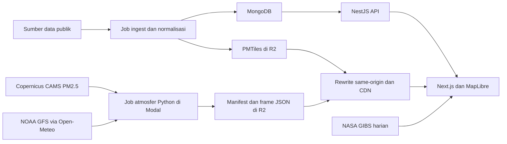

# 06 — Analisis Referensi Mandum Rimba dan Keputusan Lentera

Tanggal pemeriksaan referensi: **27 Oktober 2026**. Target: <https://www.mandumrimba.org/en>.

**Status sesudah penyelarasan:** bukti pengamatan dalam dokumen ini tetap historis dan tidak menyatakan kondisi layanan sepanjang waktu. Spesifikasi aktif terdapat pada [PRD](01-PRODUCT-REQUIREMENTS.md), [arsitektur](02-ARCHITECTURE-DESIGN.md), [UI/UX](03-UI-UX-DESIGN-SYSTEM.md), [kontrak teknis](04-TECHNICAL-SPECIFICATION.md), dan [roadmap](05-IMPLEMENTATION-ROADMAP.md). Keputusan MVP sudah ditetapkan: hotspot VIIRS, panel PM2.5 per lokasi, estimasi US AQI PM2.5 dari rerata model 24 jam, serta rekomendasi berbasis aturan. Grid/angin adalah fase lanjutan. [07](07-DOCUMENT-ALIGNMENT-AUDIT.md) mencatat penutupan audit dokumen.

Tujuan: memahami teknologi dan aliran data Mandum Rimba untuk merancang implementasi mandiri dengan tiga kemampuan: **pemantauan hotspot, informasi PM2.5/kualitas udara, dan rekomendasi tindakan masyarakat**.

## 1. Kesimpulan untuk proyek kita

Pola yang berguna adalah memisahkan pengambilan data, normalisasi, penyimpanan snapshot, dan penyajian peta. Tampilan peta merupakan keluaran dari sistem data tersebut. Lentera dapat memakai frontend Next.js/React + MapLibre, API sederhana, snapshot di object storage, dan aturan rekomendasi yang terdokumentasi. Database geospasial dan pemrosesan seluruh lapisan konservasi belum dibutuhkan untuk cakupan awal ini.

**Rekomendasi tindakan adalah fitur inti tersendiri.** Versi awal dokumen 01–05 menempatkan hero, peta, dan sumber data sebagai tiga pilar. Revisi aktif telah mengubahnya menjadi hotspot, kualitas udara dan rekomendasi; animasi angin ditempatkan setelah kebutuhan inti. Versi awal tersimpan dalam [arsip sebelum penyelarasan](research/2026-10-27-document-alignment/before-alignment.zip).

Pada awal pemeriksaan referensi, workspace berisi README dan lima dokumen rencana. Saat penyelarasan awal, aplikasi belum tersedia. Eksekusi M0 kini menambahkan fondasi aplikasi lokal; lihat [CHECKPOINT.md](CHECKPOINT.md) untuk status yang berubah setelah studi ini. Bagian observasi referensi di bawah tidak menjadi bukti integrasi atau kinerja CP.

## 2. Bukti dan batas pemeriksaan

Pemeriksaan memakai halaman publik, kode sumber publik, dan HTTP GET langsung. MCP REA belum tersedia dalam sesi ini. Browser otomatis gagal diluncurkan (Chrome berhenti dengan SIGABRT), sehingga tidak ada klaim pengujian klik, screenshot, performa, atau rendering peta secara langsung. Temuan ini bukan keluaran eksekusi mesin REA.

Repo publik: [ammar-rasyidi/mandum-rimba](https://github.com/ammar-rasyidi/mandum-rimba). Revisi `main` yang diperiksa:

`e3ce3a5d24981664dbfac6390418bc28135189ed`, commit 21 Oktober 2026.

Ada checkout terdahulu di workspace tetangga dengan HEAD `8538be08fecaeefa98c84f951dd06e100d0569c6`. Isi **14 file relevan** pada checkout itu dicocokkan menggunakan Git blob hash dengan tree revisi publik di atas; semuanya sama. Kesamaan ini memverifikasi file yang dibaca, bukan seluruh checkout atau kesamaan build produksi dengan GitHub.

Ringkasan terstruktur, fingerprint file, header HTTP terpilih, dan metadata data tersimpan di [research/2026-10-27-mandum-rimba/evidence.json](research/2026-10-27-mandum-rimba/evidence.json). Tidak ada kredensial atau kode Mandum Rimba yang disalin ke implementasi Lentera.

Tingkat bukti yang dibedakan:

- **HTTP teramati:** respons yang benar-benar diambil saat pemeriksaan.
- **Kode sumber:** teknologi/logika yang terdapat dalam revisi repo, belum tentu seluruhnya aktif di produksi.
- **Dokumentasi:** penjelasan pemilik situs; beberapa bagian tertinggal dari kode atau respons produksi.
- **Usulan Lentera:** keputusan rancangan kita sendiri.

## 3. Teknologi yang dapat diidentifikasi

| Bagian | Teknologi | Fungsi dan kekuatan bukti |
| --- | --- | --- |
| Web | Next.js App Router, React, TypeScript | Manifest menyatakan rentang Next.js `^14.2.21`, React `^18.3.1`; HTTP produksi juga mengandung header Next.js dan aset `/_next/`. Rentang manifest bukan versi patch terpasang. |
| Styling | Tailwind CSS 3, PostCSS, Autoprefixer | Dependensi dan konfigurasi web. |
| Bahasa | next-intl | Routing dan teks Indonesia/Inggris; HTML produksi menyediakan alternate locale. |
| Peta | MapLibre GL JS 5, WebGL | Render peta, sumber data geospasial, kontrol proyeksi dan terrain pada kode MapView. |
| Geometri besar | PMTiles, tippecanoe | Geometry pipeline menghasilkan arsip vector tile; peta membaca tile terpilih. |
| Analisis spasial | Turf.js | Operasi geometri pada backend. |
| API umum | NestJS 10, Express, Axios | REST API untuk wilayah, data lingkungan, dan detail. |
| Database | MongoDB dengan Mongoose | Penyimpanan dokumen dan query geospasial. **Bukan PostgreSQL** pada kode yang diperiksa. |
| Snapshot dan tile | Cloudflare R2 / S3-compatible storage | PMTiles, berkas udara, dan keluaran pipeline. Next.js melakukan rewrite same-origin ke object store. |
| Pemrosesan terjadwal | Modal, Python 3.12, job Node.js | Memisahkan pekerjaan ingest geospasial dari pekerjaan atmosfer. Jadwal didefinisikan dalam kode, bukan bukti riwayat setiap eksekusi produksi. |
| Pengolahan atmosfer | cdsapi, xarray, h5netcdf/h5py, scipy, numpy, boto3, requests | Mengambil CAMS, membaca NetCDF, mengolah grid, dan memublikasikan JSON. |
| Visualisasi udara | Raster yang dibuat di browser dan Canvas 2D | Warna berasal dari PM2.5; partikel berasal dari vektor angin. requestAnimationFrame menggerakkan animasi. |
| Grafik | Recharts | Grafik data pada frontend. |
| Pencarian tempat | OpenStreetMap Nominatim | Pencarian nama tempat dan dukungan masukan koordinat pada kode PlaceSearch. |
| Citra dan terrain | NASA GIBS/Worldview, CARTO, Esri, OpenStreetMap, AWS Terrain Tiles | Penyedia berbeda untuk citra harian, peta dasar, label, dan elevasi. |
| Build | pnpm workspaces, Turborepo | Monorepo `apps/web`, `apps/api`, dan `packages/shared`. |
| Hosting web | Vercel | Header HTTP produksi; tidak menetapkan paket akun, region database, biaya, atau seluruh topologi infra. |
| Integrasi tambahan | Google Analytics dan paket Vercel Analytics | HTML yang diambil mengandung script Google Tag Manager/GA; paket analytics juga terdaftar. Tidak diperlukan untuk tiga fitur Lentera. |
| Fitur tambahan | JSZip, togeojson, kampanye, unggah batas, fitur berbagi | Mendukung kemampuan di luar hotspot dan kualitas udara; bukan kebutuhan awal kita. |

Rujukan: [manifest web](https://github.com/ammar-rasyidi/mandum-rimba/blob/e3ce3a5d24981664dbfac6390418bc28135189ed/apps/web/package.json), [manifest API](https://github.com/ammar-rasyidi/mandum-rimba/blob/e3ce3a5d24981664dbfac6390418bc28135189ed/apps/api/package.json), [pipeline umum](https://github.com/ammar-rasyidi/mandum-rimba/blob/e3ce3a5d24981664dbfac6390418bc28135189ed/DATA-FLOW.md), [dependensi Python](https://github.com/ammar-rasyidi/mandum-rimba/blob/e3ce3a5d24981664dbfac6390418bc28135189ed/scripts/air-field/requirements.txt), [kredit situs](https://www.mandumrimba.org/en/credits).

Ini inventaris teknologi yang terlihat, bukan klaim mengetahui seluruh perangkat lunak, versi terpasang, konfigurasi privat, atau layanan internalnya.

## 4. Cara kerjanya

### 4.1 Alur umum

Alur konservasi yang besar memakai database dan tile; lapisan atmosfer mempunyai pipeline mandiri. Tidak semua data melewati backend NestJS. Rewrite web meneruskan `/air/*` dan `/tiles/*` ke object store, sehingga URL browser tetap pada domain situs. Lihat [next.config.mjs](https://github.com/ammar-rasyidi/mandum-rimba/blob/e3ce3a5d24981664dbfac6390418bc28135189ed/apps/web/next.config.mjs).

### 4.2 Hotspot: bedakan gambar historis dan titik yang dapat diperiksa

Pada registry layer yang diperiksa, layer hotspot harian aktif menggunakan **NASA GIBS WMS sebagai gambar raster**. Gambar ini memungkinkan penelusuran hari tertentu, tetapi tidak menyediakan objek deteksi individual untuk diklik atau dihitung langsung. Citra true-colour harian memakai WMTS. Rujukan: [gibs.ts](https://github.com/ammar-rasyidi/mandum-rimba/blob/e3ce3a5d24981664dbfac6390418bc28135189ed/apps/web/src/lib/gibs.ts).

Kode juga menyediakan dua endpoint GeoJSON berbasis NASA FIRMS:

- Route Next.js `/api/fires`.
- Controller NestJS `/v1/fires`.

Keduanya membaca CSV VIIRS S-NPP, mengubah koordinat menjadi GeoJSON, dan memakai cache. Namun definisi layer `fires` yang menunjuk ke NestJS dalam registry saat ini **dikomentari**. Keberadaan endpoint tidak membuktikan bahwa UI sedang memakainya. Rujukan: [registry layer](https://github.com/ammar-rasyidi/mandum-rimba/blob/e3ce3a5d24981664dbfac6390418bc28135189ed/apps/web/src/lib/layers.ts), [route Next.js](https://github.com/ammar-rasyidi/mandum-rimba/blob/e3ce3a5d24981664dbfac6390418bc28135189ed/apps/web/src/app/api/fires/route.ts), [controller NestJS](https://github.com/ammar-rasyidi/mandum-rimba/blob/e3ce3a5d24981664dbfac6390418bc28135189ed/apps/api/src/api/fires.controller.ts).

**Pengamatan HTTP penting:** pada 27 Oktober 2026 sekitar 13:36 UTC / 20:36 WIB, `/api/fires` mengembalikan HTTP 200, `x-fires: ok-4417`, dan **4.417 rekaman yang semuanya bertanggal 20 Oktober 2026**. Payload yang disimpan berukuran 806.236 byte. Ini satu snapshot respons; tidak membuktikan penyebab data lama, perilaku UI, ataupun status sumber NASA secara keseluruhan.

Pelajaran untuk Lentera: jangan menafsirkan HTTP 200 atau cache yang baru diakses sebagai bukti data deteksi terbaru. Waktu akuisisi satelit harus diperiksa secara terpisah. Jumlah rekaman juga bukan jumlah kebakaran yang sudah dikonfirmasi. Query bbox perlu dipotong memakai batas wilayah jika angka akan diberi label nasional.

### 4.3 PM2.5 dan angin

1. Job Python memperoleh grid PM2.5 dari **Copernicus ADS/CAMS**, bukan mengunduh ribuan titik PM2.5 setiap kali pengguna membuka peta.
2. Angin 10 meter berasal dari **NOAA GFS melalui endpoint cuaca Open-Meteo**.
3. Job menormalkan grid, waktu, dan vektor angin, lalu menerbitkan manifest serta berkas JSON per jam ke R2.
4. Browser membaca `/air/index.json`, memilih waktu yang diperlukan, lalu mengambil frame sebelum/sesudahnya. Manifest menunjuk prefix build tertentu, sehingga frame dari dua build berbeda tidak tercampur.
5. PM2.5 dirasterisasi untuk layer warna. Partikel Canvas 2D mengambil sampel vektor angin untuk animasi. Interpolasi ruang/waktu memperhalus tampilan; tidak menambah resolusi pengamatan.

Kode Modal menjadwalkan job udara pada **11:00 dan 23:00 UTC**, terpisah dari job geospasial. Keterangan jadwal pada beberapa halaman publik berbeda; laporan ini mendahulukan kode untuk jadwal yang didefinisikan, dan respons HTTP untuk data yang benar-benar tersaji. Rujukan: [modal_air.py](https://github.com/ammar-rasyidi/mandum-rimba/blob/e3ce3a5d24981664dbfac6390418bc28135189ed/modal_air.py), [builder](https://github.com/ammar-rasyidi/mandum-rimba/blob/e3ce3a5d24981664dbfac6390418bc28135189ed/scripts/air-field/build_air_field.py), [AirField](https://github.com/ammar-rasyidi/mandum-rimba/blob/e3ce3a5d24981664dbfac6390418bc28135189ed/apps/web/src/components/map/AirField.tsx).

Manifest produksi yang diambil menunjukkan:

| Metadata | Nilai teramati |
| --- | --- |
| Sumber PM2.5 | `cams-ads` |
| Cakupan | 60°E–180°E, 50°S–60°N |
| Grid PM2.5 | 301 × 276 = 83.076 nilai, langkah 0,4° |
| Grid angin | 49 × 45 = 2.205 nilai per komponen, langkah 2,5° |
| Run model | 27 Oktober 2026 00:00 UTC |
| Waktu berkas dibuat | 27 Oktober 2026 11:09:20 UTC |
| Waktu berlaku frame | 27 Oktober 09:00 sampai 29 Oktober 11:00 UTC, per jam |

Satu frame pada 27 Oktober 13:00 UTC berhasil diambil: panjang array PM2.5, u, dan v sesuai dimensinya. Ini memverifikasi struktur data yang tersaji, belum akurasi prediksi atau tampilan browser. Sumber langsung: [manifest produksi](https://www.mandumrimba.org/air/index.json).

### 4.4 Indeks kualitas udara

Mandum Rimba mempunyai fungsi konversi PM2.5 ke **subindeks US AQI menggunakan breakpoint EPA revisi 2024**. Fungsi tersebut menerima satu konsentrasi; fungsi konversi saja tidak membuktikan penerapan rata-rata paparan atau NowCast pada setiap tempat pemanggilannya. Kode juga menandai extrapolasi di atas AQI 500. Rujukan: [aqi.ts](https://github.com/ammar-rasyidi/mandum-rimba/blob/e3ce3a5d24981664dbfac6390418bc28135189ed/packages/shared/src/aqi.ts).

Untuk Lentera, **PM2.5 dalam µg/m³ menjadi angka utama**. Indeks pelengkap harus menyebut jenis dan metode waktunya. Keputusan MVP yang telah diambil dari usulan awal: `Estimasi US AQI PM2.5 — rerata bergerak 24 jam dari model`. Ini bukan AQI resmi stasiun, bukan ISPU Indonesia, dan bukan indeks gabungan seluruh polutan. Ambil rangkaian jam sebelumnya yang cukup; jika tidak lengkap, status indeks menjadi tidak tersedia. Jangan langsung menerapkan breakpoint 24 jam pada satu angka sesaat lalu menamakannya AQI resmi.

ISPU Indonesia bukan metode MVP. Perubahan metode pada fase berikutnya harus memperbarui implementasi, kategori, warna dan rekomendasi secara bersamaan, bukan mengganti nama US AQI. Landasan pembeda: [EPA tentang AQI dan NowCast](https://www.epa.gov/wildfire-smoke-course/using-air-quality-index-aqi-plan-daily-activities), [dokumen breakpoint EPA 2024](https://www.epa.gov/system/files/documents/2024-02/pm-naaqs-air-quality-index-fact-sheet.pdf), [penjelasan ISPU KLH](https://ppmu.kemenlh.go.id/portal/read/indeks-standar-pencemar-udara-ispu-sebagai-informasi-mutu-udara-ambien-di-indonesia).

Partikel angin tidak membuktikan asap dari hotspot tertentu akan tiba di rumah tertentu. Angin permukaan merupakan konteks; atribusi sumber asap memerlukan analisis transport dan emisi yang berbeda.

## 5. Cakupan produk yang ditetapkan untuk MVP

| Kebutuhan | Implementasi awal | Pengembangan berikutnya |
| --- | --- | --- |
| Pemantauan hotspot | MapLibre + GeoJSON FIRMS, filter rentang/jam/confidence/satelit, detail waktu dan sumber, pencarian wilayah | Riwayat lebih panjang, validasi laporan lapangan, perbandingan sensor |
| PM2.5/kualitas udara | Panel lokasi: PM2.5 saat jam terpilih, label model, prakiraan dan riwayat untuk indeks, satu metode indeks eksplisit | Grid warna PM2.5 regional dan pembandingan dengan stasiun yang tersedia |
| Rekomendasi masyarakat | Panel “Tindakan untuk lokasi ini”, aturan transparan berdasar indeks, kelompok pengguna, dan status data | Notifikasi opt-in dan integrasi kanal lokal yang sudah diverifikasi |
| Transparansi | Sumber, metode, waktu deteksi/run/berlaku, status kesegaran dan gangguan | Halaman kesehatan pipeline lengkap |

Fitur satwa, konsesi, kampanye, permainan, 3D terrain, unggah KMZ, dan pelacakan rantai pasok tidak diperlukan untuk versi awal ini. Pilihan tersebut mengurangi kebutuhan tile berat, database geospasial, dan ingest lintas domain.

## 6. Penurunan hasil analisis ke arsitektur aktif

Pola yang dipertahankan adalah pemisahan pengambilan data dari tampilan, penyimpanan last-good persisten, provenance dan cache yang tidak menghapus umur sumber. Keputusan aktif memakai satu aplikasi Next.js/MapLibre, job Node.js terjadwal, Cloudflare R2, dan adapter Open-Meteo per lokasi. Detail alur/hosting berada pada [02](02-ARCHITECTURE-DESIGN.md); interval, status, retensi dan kontrak API hanya didefinisikan kanonis pada [04](04-TECHNICAL-SPECIFICATION.md).

Endpoint MVP adalah `/api/hotspots`, `/api/air`, dan `/api/recommendations`. Angin menggunakan provider cuaca yang berbeda pada fase lanjutan, bukan tambahan variabel pada endpoint air-quality. Pemilihan API, key, paket layanan, geometri dan biaya diverifikasi melalui M0 pada [05](05-IMPLEMENTATION-ROADMAP.md).

Arsitektur referensi memakai MongoDB dan tile untuk kebutuhan yang lebih luas. Tidak ada keharusan memakai database, NestJS, PMTiles atau Python atmosfer dalam MVP Lentera. Implementasi dan aset Lentera dibuat sendiri; source Mandum hanya bahan studi.

## 7. Penurunan hasil analisis ke rekomendasi masyarakat

Rekomendasi deterministik merupakan bagian MVP dan mengambil data tervalidasi dari layanan udara server. Kontrak kini menetapkan kelompok general/sensitive/outdoor, versi aturan, alasan, sumber pedoman, versi data dasar dan deadline. Pada data stale/partial/unavailable atau indeks yang tidak dapat dihitung, hasil berbentuk keterbatasan dan pedoman umum, bukan rekomendasi kategori terkini.

Label indeks tetap estimasi dari model dengan periode 24 jam yang dijelaskan. Aturan dan teks kategori kanonis terdapat pada [04](04-TECHNICAL-SPECIFICATION.md); presentasi dan pemisahan tindakan kini dari grafik prakiraan berada pada [03](03-UI-UX-DESIGN-SYSTEM.md). CP memilih menampilkan nilai di luar skala sebagai “>500”, tanpa meniru extrapolasi numerik pada situs referensi. Informasi hotspot tidak menjadi bukti atribusi asap atau instruksi evakuasi.

Pedoman asal dan proses pemeriksaan konten dicatat pada 04 serta M4/M6. Kontak lokal hanya dipakai jika terverifikasi. Dokumen analisis ini tidak mengklaim bahwa rekomendasi sudah diuji pada aplikasi.

## 8. Koreksi terhadap versi awal dokumen 01–05 — catatan historis

Tabel berikut menjelaskan masalah pada **versi sebelum revisi**, bukan daftar cacat yang masih berlaku pada spesifikasi aktif. Perbaikannya sudah diturunkan ke 01–05 dan dicatat pada [07](07-DOCUMENT-ALIGNMENT-AUDIT.md); naskah sebelumnya ada dalam arsip yang ditautkan di awal.

| Rencana awal | Koreksi dari pemeriksaan |
| --- | --- |
| Mandum memakai PostgreSQL | Kode memakai MongoDB/Mongoose. |
| Tiga fitur utama = hero, peta, sumber | Kebutuhan terbaru = hotspot, udara, rekomendasi; hero dan sumber adalah pendukung. |
| PM2.5 dan angin diminta pada endpoint air-quality yang sama | Uji nyata menghasilkan 24 nilai PM2.5 tetapi **0 nilai angin non-null**; endpoint forecast GFS terpisah menghasilkan 24/24 nilai kedua variabel angin. |
| API FIRMS country menjadi fondasi | Katalog NASA saat diperiksa menandai country/countries tidak tersedia; gunakan Area API dan validasi dukungan aktual. |
| Permintaan 7 hari sekali jalan | Dokumentasi Area API saat diperiksa membatasi `DAY_RANGE` 1–5; pecah rentang dan deduplikasi. Angka hari kalender belum sama dengan rolling 24/48 jam. |
| Semua data disebut real-time/live sensor | Hotspot adalah pengamatan satelit berkala; CAMS adalah model. Tampilkan tanggal akuisisi, run dan waktu berlaku. |
| Angin dianggap jalur asap | Visualisasi angin tidak membuktikan lintasan atau sumber asap. |
| Confidence VIIRS High = 92% | VIIRS menggunakan kategori l/n/h. Jangan membuat persentase dari kategori. MODIS memerlukan normalisasi instrumen tersendiri. |
| Warna AQI dibuat sebagai palet merek | Gunakan kategori standar yang dipilih; US AQI memiliki enam kategori, dan merah berarti Unhealthy, bukan kategori tertinggi Hazardous. |
| Wilayah terburuk/nilai nasional bisa langsung ditampilkan | Harus ada cakupan dan agregasi yang memadai; jangan mengklaim maksimum nasional dari beberapa titik sampel. |
| 60 FPS dan payload 30–80 KB diperlakukan sebagai hasil teruji | Belum diuji di CP; contoh respons hotspot situs bahkan sekitar 806 KB sebelum memperhitungkan transfer compression. Jadikan target ukur, bukan jaminan. |
| Tanpa database berarti tanpa penyimpanan | Snapshot persisten tetap dibutuhkan untuk histori, fallback, dan audit kesegaran. |
| Rp0 per bulan dijamin | Target biaya rendah perlu dihitung dari trafik, job, storage, dan syarat API. Free API Open-Meteo dibatasi penggunaan nonkomersial dan kuota. |
| Menulis ulang sendiri berarti bebas seluruh lisensi | Kode dan identitas Lentera dibuat sendiri; library, basemap, serta dataset tetap mempunyai ketentuan dan atribusi masing-masing. |

Rujukan koreksi API: [NASA FIRMS API](https://firms.modaps.eosdis.nasa.gov/api/), [NASA Area API](https://firms.modaps.eosdis.nasa.gov/api/area/), [Open-Meteo Air Quality](https://open-meteo.com/en/docs/air-quality-api), [Open-Meteo GFS](https://open-meteo.com/en/docs/gfs-api), [ketentuan Open-Meteo](https://open-meteo.com/en/terms), [kategori AQI AirNow](https://www.airnow.gov/aqi/aqi-basics/).

Untuk menghormati tujuan pengguna, gunakan API/sumber aslinya, kode Lentera yang ditulis sendiri, dan identitas visual sendiri. Jangan menjadikan endpoint publik Mandum Rimba sebagai upstream produksi Lentera. Situs referensi menyatakan kode AGPL dan merek/aset mempunyai aturan tersendiri; lihat [kredit dan sumber proyek](https://www.mandumrimba.org/en/credits).

## 9. Status dan tindak lanjut

Analisis dan penyelarasan dokumentasi selesai. Implementasi mengikuti M0–M6 pada [05](05-IMPLEMENTATION-ROADMAP.md): fondasi/provider, snapshot hotspot, peta/lokasi, udara/indeks, tindakan, UX/transparansi, lalu verifikasi dan rilis. Grid/angin tetap fase berikutnya.

Fondasi aplikasi lokal telah mulai diimplementasikan pada M0. Scheduler, akun/key cloud, pengujian end-to-end dan deployment belum diaktifkan/terverifikasi; keadaan terbaru dilacak di CHECKPOINT.md. Bukti HTTP/source referensi pada bagian 2–4 dan folder research dipertahankan; tidak diubah menjadi klaim kinerja CP.
